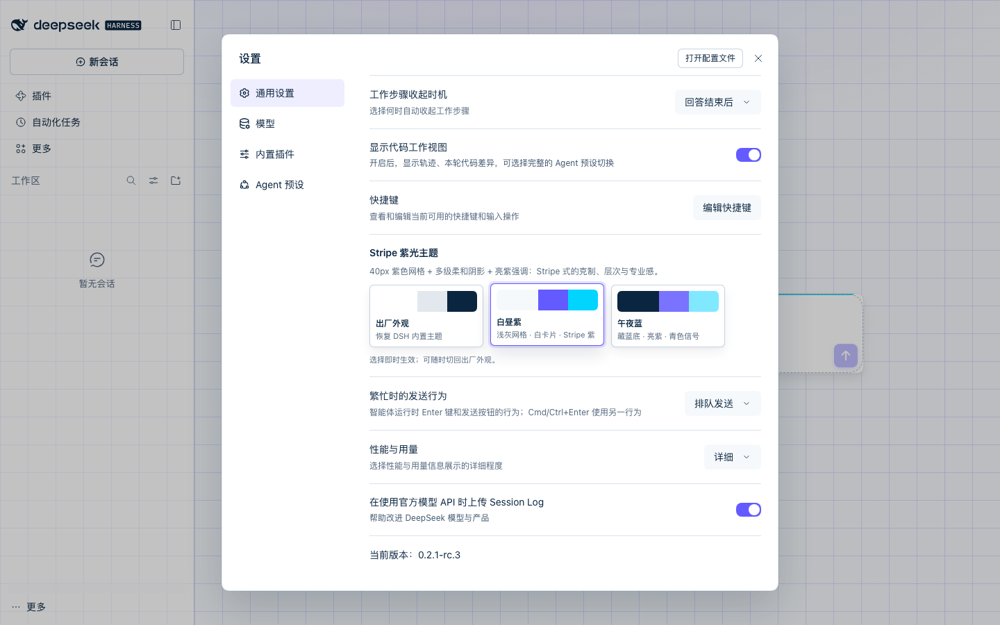
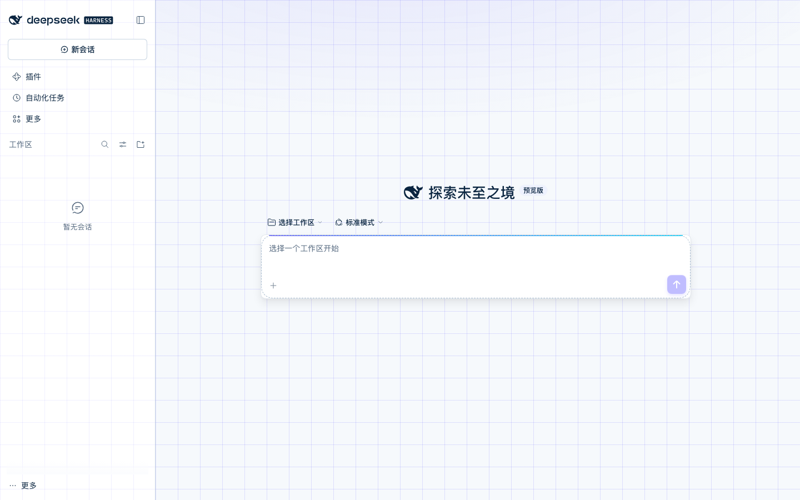
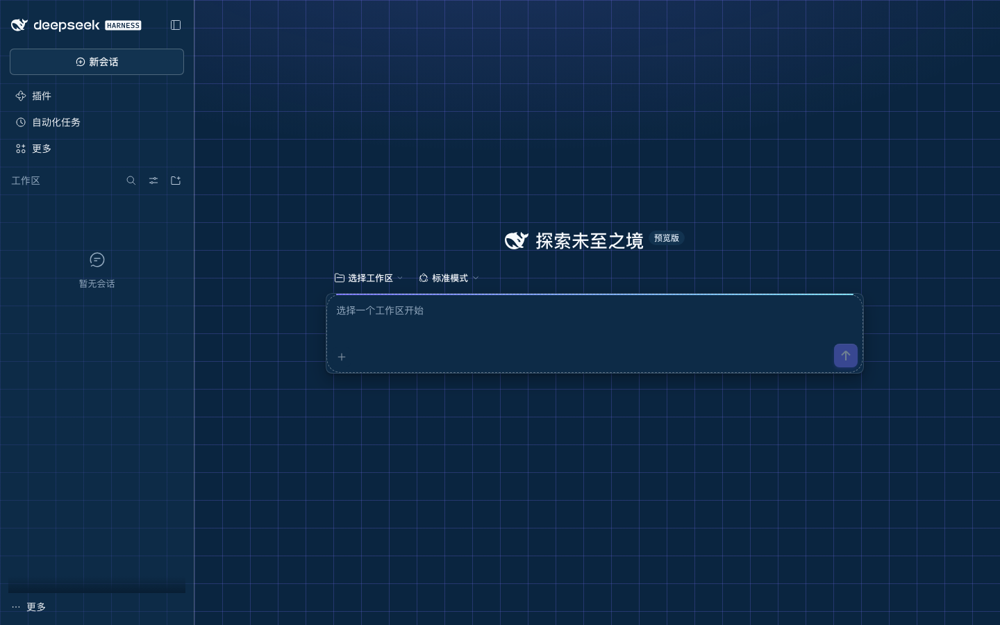
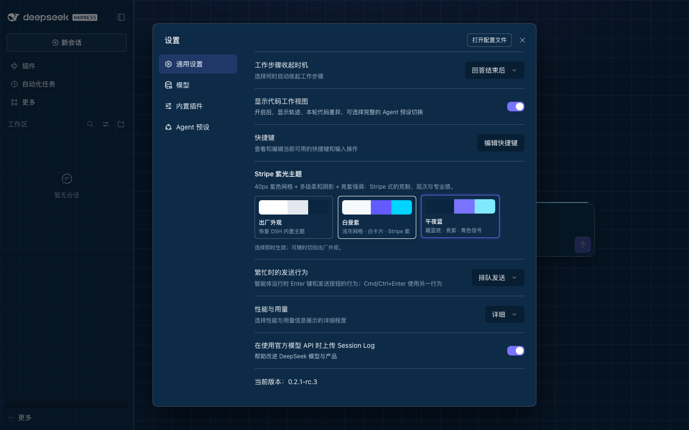

# dsh-theme-stripe-style

Stripe 风格主题插件，给 DeepSeek Harness Web GUI 换上「紫色网格 + 多级柔和阴影 + 亮紫强调」的外观。参考 [StyleKit 的 Stripe Style 规范](https://www.stylekit.top/styles/stripe-style/showcase)，只改外壳与设计 token，不动对话排版。



| 白昼紫 | 午夜蓝 |
| --- | --- |
|  |  |

## 特性

- **两套主题，设置内一键切换**：`白昼紫`（`#f6f9fc` 底 / 白卡片 / `#635bff` 主色）与 `午夜蓝`（`#0a2540` 官方深色 / 深蓝卡片 / `#7a73ff` 主色）。
- **安装后自动启用**：首次加载按当前明暗自动套用对应版本；之后记住选择。不想用时在 **设置 → 通用 → Stripe 紫光主题** 里点「出厂外观」即可完全恢复。
- **Stripe 式空间感**：全窗 40px 紫色细网格 + 顶部紫色径向光晕；卡片浮在网格上，用两层级联柔和阴影建立层次，hover 上浮 2px、按下 `scale(.98)` + 内阴影。
- **克制的结构**：卡片 12px、按钮/输入/菜单 8px 圆角；`1px` 低对比描边；1px 细线分隔；亮紫只用于主按钮、选中态、焦点环和关键高亮。
- **签名细节**：输入区顶部 2px 紫→青渐变线；聚焦时 3px 紫色扩散环 + 加深阴影；设置行主题卡选中时紫环 + 上浮。
- **阅读区保持安静**：不改 Markdown 排版、字号、行宽；浅色版代码块保持浅底（避免 shiki 正文色不可读），深色版用深底浅字。
- **可访问性**：正文/次要文字/链接/主按钮的 WCAG 对比度在 `test/theme.test.mjs` 中自动校验；键盘焦点 3px 紫环；遵循 `prefers-reduced-motion`。
- **干净的生命周期**：主题注册、样式表、body 标记、监听器全部挂在插件生命周期上，禁用/卸载即恢复原样。
- **零外部依赖**：不加载网络字体、图片、音频；不依赖 CSS-module 哈希类名。

设置页里的主题行：



## 安装

插件兼容 **DSH Web 0.2.1 线**（在 `0.2.1-rc.3` 上完成端到端验证，见 [`docs/VERIFICATION.md`](docs/VERIFICATION.md)）。

### 从 npm 安装（推荐）

```sh
dsh plugin --profile web add dsh-theme-stripe-style@0.1.0
```

装完重启对应的 `dsh web` / 桌面应用。npm 包与 GitHub Release 包内容一致，插件市场原生的「发现」索引也会直接识别 npm 版本。

### 从 GitHub Release 安装（备选）

预构建包挂在 GitHub Release 上，直接装，不需要 clone 或构建：

```sh
dsh plugin --profile web add https://github.com/Jimxinfang/dsh-theme-stripe-style/releases/download/v0.1.0/dsh-theme-stripe-style-0.1.0.tgz
```

装完重启对应的 `dsh web` / 桌面应用（Host 只在启动时扫描插件清单，之后换主题即时生效）。

### 本地目录安装（开发 / 自用）

```sh
# 在插件目录内，一条命令安装到 Web profile
./scripts/install-local.sh

# 安装到 DSH Desktop 的 desktop profile：先完全退出桌面应用，再执行，然后重新打开
./scripts/install-local.sh desktop

# 卸载时把 install 换成 uninstall
./scripts/uninstall-local.sh desktop
```

脚本会自动找到 DSH 自带的 `dsh` CLI（macOS 桌面版路径）；非标准安装可设 `DSH_CLI=/path/to/dsh`。也可以直接调用：

```sh
dsh plugin --profile web add /absolute/path/to/dsh-theme-stripe-style
```

安装后重启对应的 `dsh web` / 桌面应用。Host 只在启动时扫描浏览器插件清单，所以新增插件需要重启一次；之后换主题都是即时的。

> DSH Desktop 的 `desktop` profile 归应用自己的插件管理器所有。若命令行安装被应用覆盖或拒绝，可以 `npm pack` 生成 tarball 后发布/安装，或把插件发布到 npm 后从插件市场安装。

### 压缩包安装

```sh
npm pack                    # 生成 dsh-theme-stripe-style-0.1.0.tgz
dsh plugin --profile web add ./dsh-theme-stripe-style-0.1.0.tgz
```

Release 里的 `dsh-theme-stripe-style-0.1.0.tgz` 与 `npm pack` 产物一致（含主题代码、图标、验证说明与截图）。

### 发布到插件市场

市场目录收录在 [awesome-dsh-plugin](https://github.com/awesome-dsh-plugin/awesome-dsh-plugin)，一条目录项就是全部投稿：

1. 仓库已就绪：`dsh.bundle.patch` 清单、`cordis.patch.yml`、真实可运行代码、`dsh-plugin` topic、`screenshots.json`（6 张截图）、Release 预构建包。
2. 目录项 `data/plugins/Jimxinfang__dsh-theme-stripe-style.yml` 使用 `category: theme` + `tarball:` 指向 Release 包；仓库创建满 1 天后提 PR（目录 CI 自动检查仓库年龄），维护者会在合并前实际阅读代码。
3. npm 包已发布（`dsh-theme-stripe-style@0.1.0`），market catalog 会从 npm registry 自动识别版本，市场「发现」索引可直接安装；GitHub Release 包作为离线/固定版本备选。

## 使用

1. 打开 **设置 → 通用**，滚动到 **Stripe 紫光主题**。
2. 点 `白昼紫` 或 `午夜蓝`。选择立即生效并跨重启保留。
3. 点 `出厂外观` 恢复 DSH 内置的浅色/深色/跟随系统。之后再点内置外观，插件不会抢回主题。

偏好记录在浏览器 `localStorage` 的 `dsh-theme-stripe-style.preference`；主题本身通过 DSH 官方 `ctx.theme` 服务注册与切换。

## 卸载

```sh
dsh plugin --profile web remove dsh-theme-stripe-style
```

卸载或热禁用会释放主题注册、移除样式和 `body[data-dsh-stripe-style]` 标记，界面恢复原样。

## 开发与验证

```sh
npm run check        # node --check
npm test             # token 完整性 / 对比度 / CSS 门控 / 注入契约 / 生命周期
```

端到端验证使用独立 `DSH_HOME` + 独立端口的 `dsh web` 实例，Playwright 驱动系统 Chrome，覆盖首次自动启用、白昼紫/午夜蓝切换、设置行、390px 移动端、出厂恢复，并断言无 console/page error。结果：**40/40 hard assertions 通过**（另有 8/9 soft checks，1 项为 harness 元检查的预期 WARN）。详见 [`docs/VERIFICATION.md`](docs/VERIFICATION.md)。

## 文件结构

```text
dsh-theme-stripe-style/
├── package.json          # dsh.bundle.patch + dsh.client 清单
├── cordis.patch.yml      # 唯一的 loader 行
├── index.js              # Host 半：空 apply()
├── client.js             # 浏览器半：主题注册 + 结构 CSS + 设置行
├── test/theme.test.mjs   # 不依赖浏览器的静态校验
├── test/runtime.test.mjs # 用假 DOM 校验生命周期与恢复逻辑
├── docs/                 # 验证说明与截图
└── DESIGN.md             # 设计系统说明
```

## 已知边界

- DSH 的聊天气泡、Markdown 根节点、工具卡内部等使用 CSS-module 哈希类名；主题刻意只改稳定语义 hook 和设计 token，不碰这些内部结构。
- 头像、状态点等身份/状态圆形保持原样，保留可识别性。
- 系统 Chrome 的 `color-mix()` / `:has()` 均在 DSH 支持范围内；老版本 WebView 会回退到不带网格的纯色背景。
- 本插件是纯展示插件，不注册任何模型可见的工具，不影响 agent 行为。
